<div align="center">


### Movies for everyone in Sri Lanka, even without a data plan.

A full-stack movie and TV-series platform that **delivers films through WhatsApp** and helps viewers
discover what to watch with a **TikTok-style short-clip feed**.


</div>

<p align="center">
  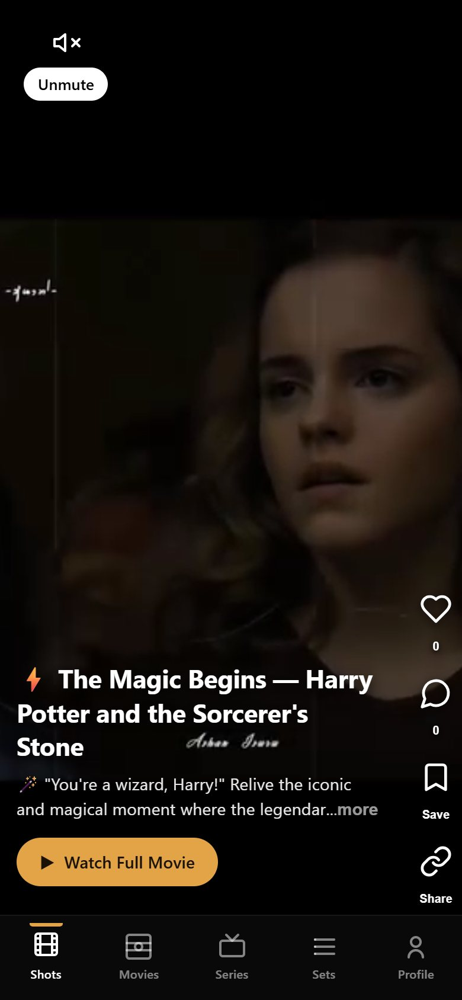
  &nbsp;&nbsp;
  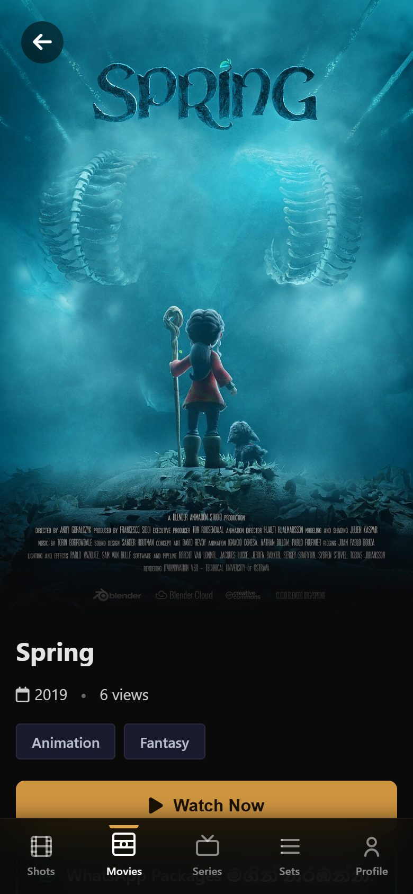
  &nbsp;&nbsp;
  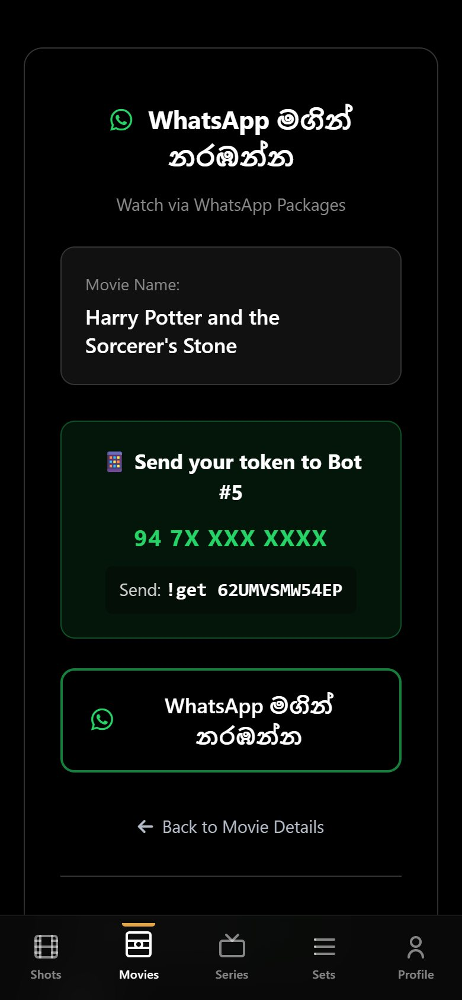
</p>

---

## The problems I set out to solve

### 1. In Sri Lanka, mobile data is too expensive to stream movies

Mobile network providers in Sri Lanka charge a lot for data. A single movie can use one to two
gigabytes, so **for many people, streaming or downloading a film online is simply not affordable**.

But I noticed something in the same market: providers sell **unlimited WhatsApp packages at very
low prices**. Almost everyone already has one.

**My solution:** deliver movies *through WhatsApp*. A viewer picks a movie on Zinema.lk, receives a
one-time token, and sends it to the Zinema WhatsApp number. The full movie arrives right in their
chat, using their cheap unlimited WhatsApp package instead of expensive mobile data.

> With one low-cost WhatsApp package, a viewer can watch as many movies as they like.

### 2. Long trailers don't fit how people discover content today

People's lives are busy, and short videos now dominate how we decide what to watch. Sitting through
a two-minute trailer feels slow when a 20-second clip can tell you whether you'll like a film.

**My solution: Shots**, a vertical, TikTok-style feed of short movie clips. Swipe through moments
from movies and series, and when one catches your eye, tap **Watch Full Movie** to go straight to it.
Unlike most streaming platforms, where discovery still means browsing posters and long trailers,
every clip here is one tap away from the full movie.

---

## How it works

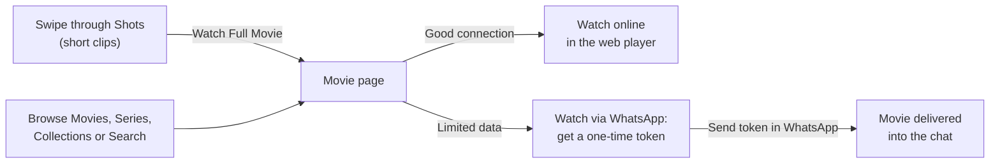

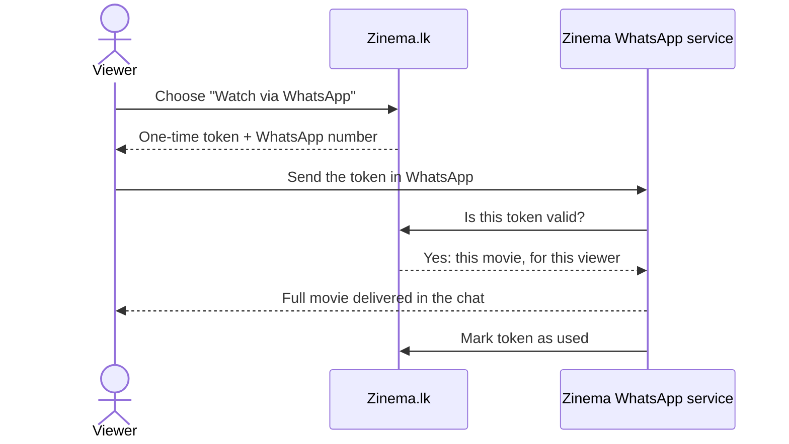

---

## Screenshots

All screenshots are from the running application, using a demo catalogue of openly licensed films
(see [Demo content and credits](#demo-content-and-credits)). The bot status in the admin screenshots
is sample data. For a real WhatsApp delivery, see [A real delivery, end to end](#a-real-delivery-end-to-end).

### From a short clip to the full movie

| 1. A short clip in the Shots feed | 2. Tap "Watch Full Movie" and it plays |
|:---:|:---:|
| 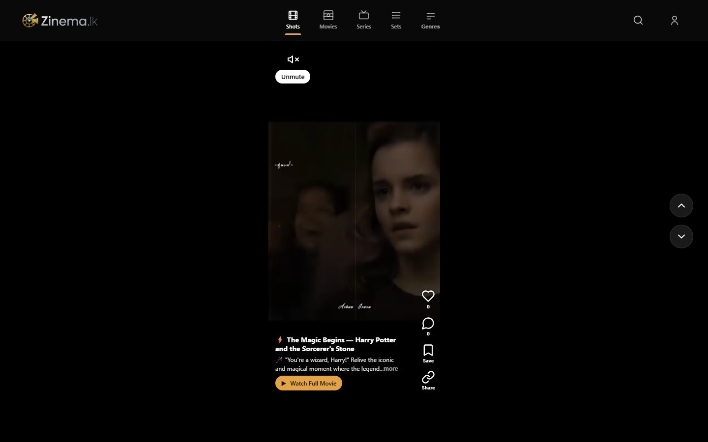 | 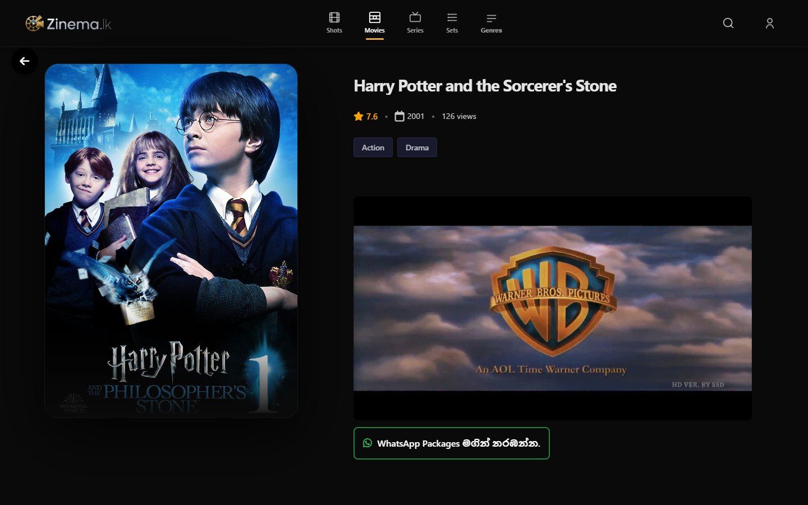 |
| **3. Or watch it via WhatsApp: a one-time token** | **The movie page** |
| 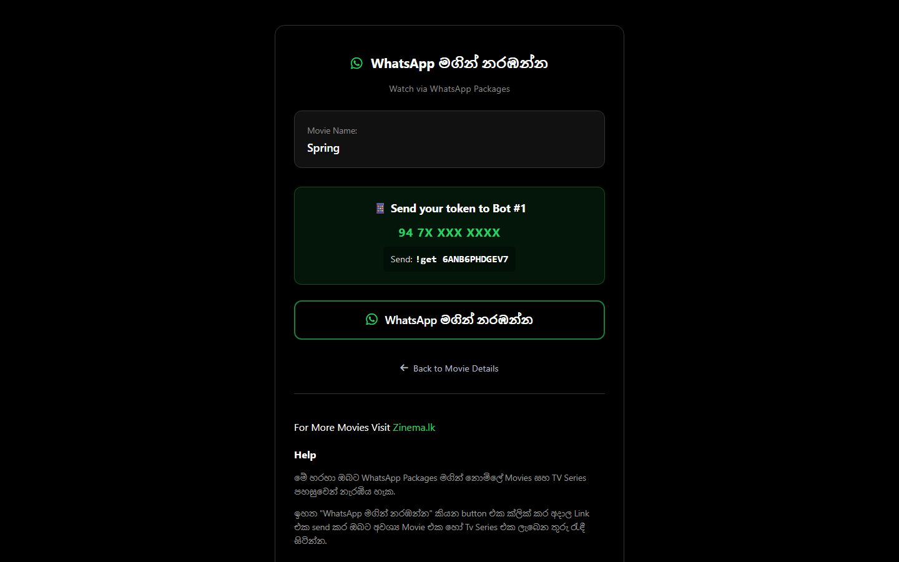 | 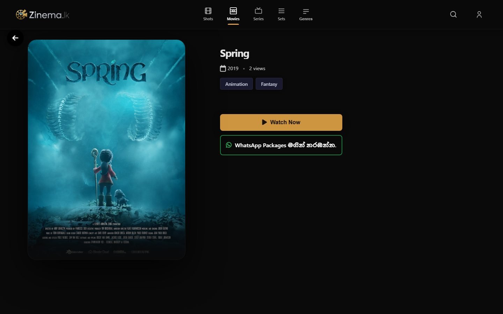 |

### Browsing

| Movies | Collections |
|:---:|:---:|
| 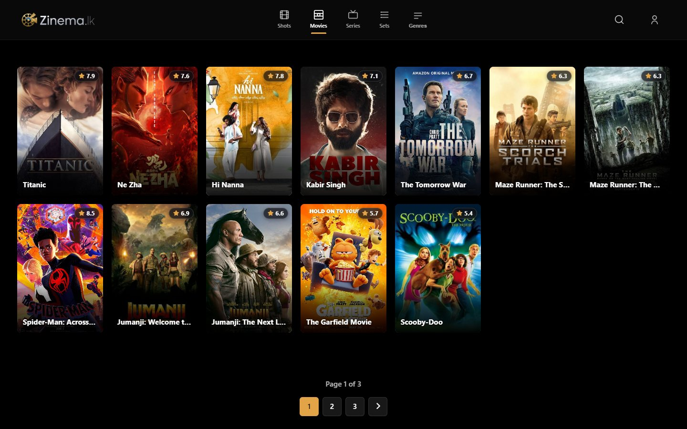 | 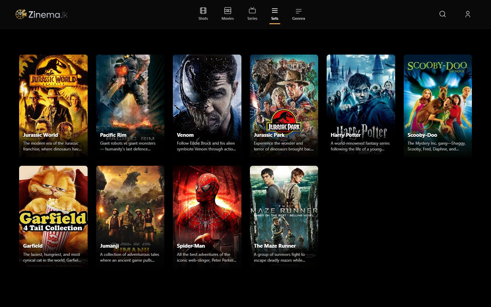 |

### Built for phones first

<p align="center">
  
  &nbsp;
  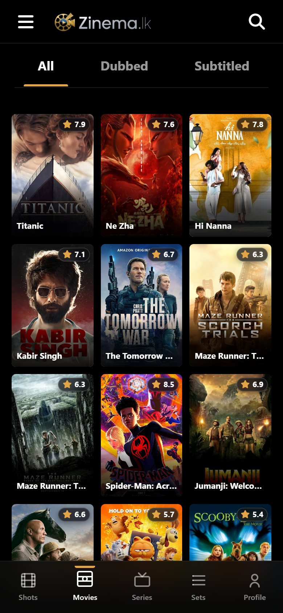
  &nbsp;
  
  &nbsp;
  
</p>

### Admin panel

| Dashboard | WhatsApp bot monitoring |
|:---:|:---:|
| 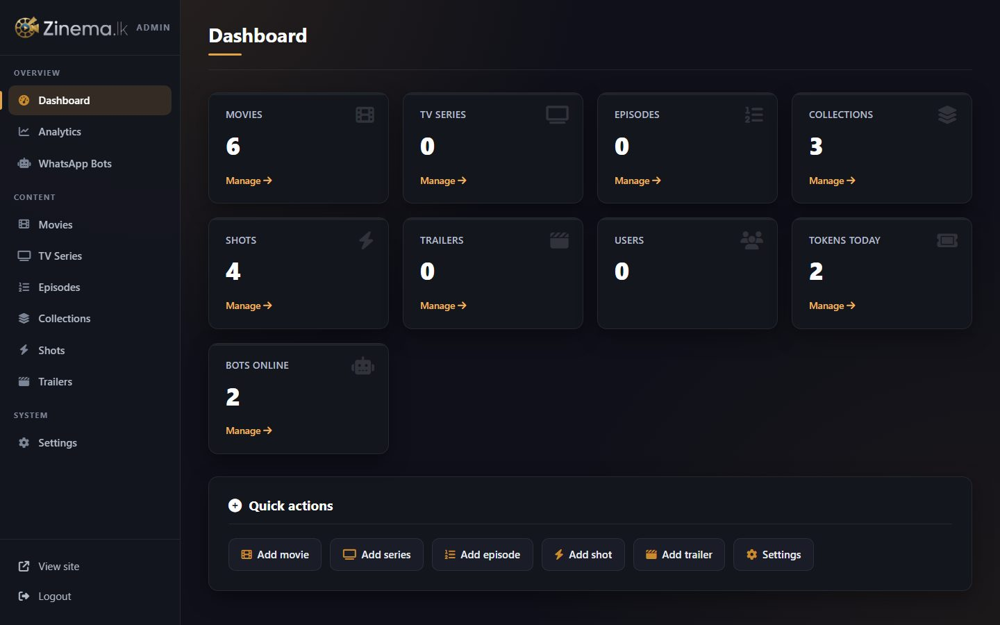 | 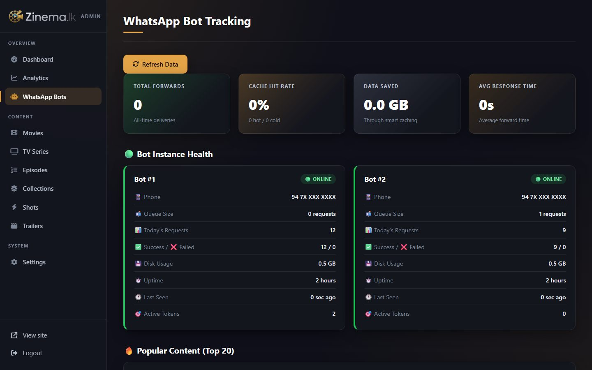 |
| **Shots management with live API status** | |
| 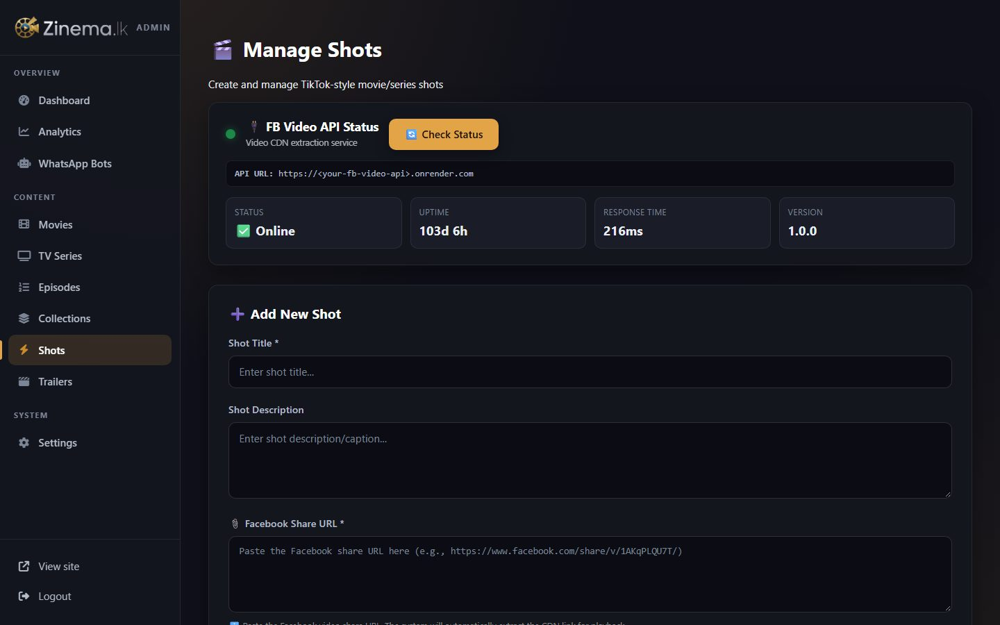 | |

---

## Features

**For viewers**
- **Shots**: a vertical short-clip feed with autoplay, likes, comments, saves and sharing; every clip links to its full movie or series.
- **Watch via WhatsApp**: one-time tokens that turn any movie or episode into a WhatsApp delivery.
- **Web player** for viewers with a good connection.
- Movies, TV series with seasons and episodes, curated collections, genre filters and live search.
- Accounts with email verification, password reset and Google sign-in support.
- A mobile-first interface with bottom navigation, infinite scroll and clean, shareable URLs.

**For administrators**
- A content manager for movies, series, episodes, collections, trailers and shots.
- Shots are added by pasting a Facebook video link; the platform turns it into a playable clip automatically.
- A **WhatsApp bot monitoring** dashboard: which bots are online, queue size, requests and uptime.
- Analytics (page views, watch time), site settings and a dashboard with live counts.

---

## The WhatsApp delivery service

The WhatsApp service is the heart of Zinema.lk. It is a separate service I built, and its design is
intentionally kept private. What it does:

- **Receives tokens** that viewers send in WhatsApp and checks each one with the platform.
- **Delivers the requested movie or episode** straight into the viewer's chat, including large, full-length films.
- **Serves many viewers at once** with a fair request queue, across **multiple bot numbers** with automatic load balancing.
- **Reports its health** to the platform every minute. The website only hands out tokens for bots that are really online, and admins see every bot's status live.
- **Prevents abuse**: tokens are single-use, expire after a few minutes and are rate-limited.

### A real delivery, end to end

These three screenshots show one real delivery on 4 November 2026. The same token,
`4NLDPBYVRQSL`, appears in all of them. The bot log shows the 1.5 GB film delivered within about two
seconds of the token being processed. Personal details and internal identifiers are blurred.

| 1. The website gives the viewer a token and a bot number | 2. The token is sent in WhatsApp and the full film arrives |
|:---:|:---:|
| 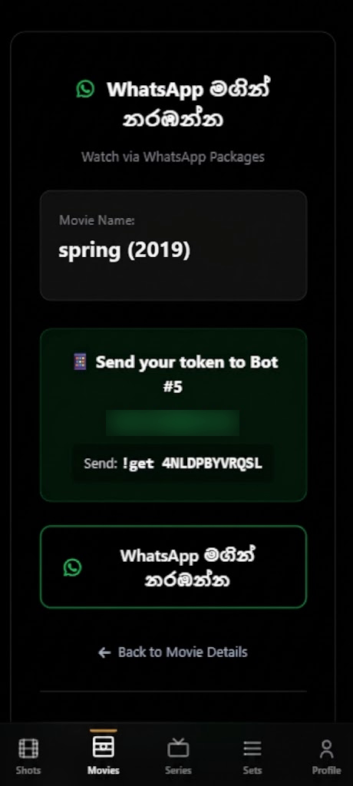 | 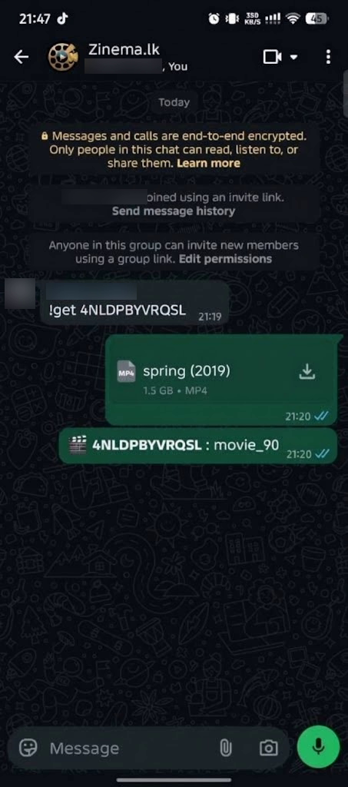 |

<p align="center">
  <strong>3. The bot's own log of the same request: token validated, video delivered, queue cleared</strong>
  <br><br>
  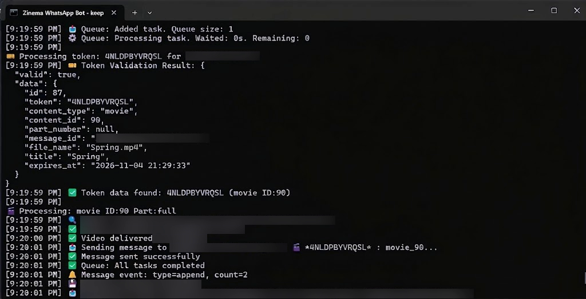
</p>

---

## Architecture

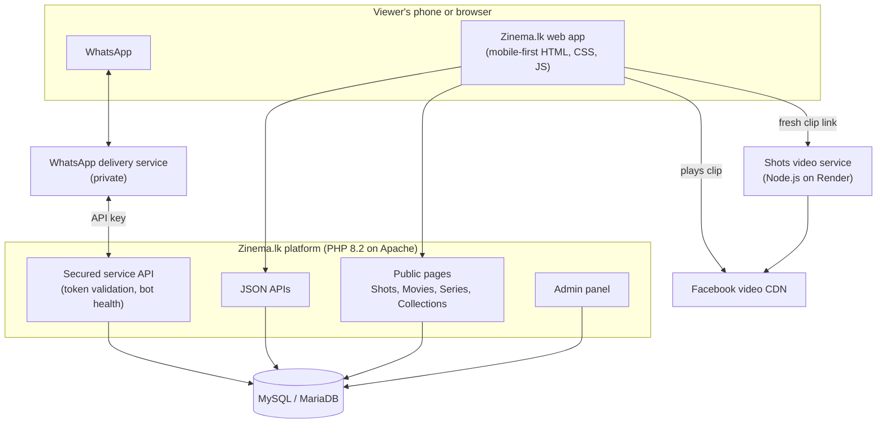

- **Platform:** a PHP 8.2 application with a MySQL/MariaDB database. Public pages, the admin panel and JSON APIs share one configuration and security layer.
- **Shots video service:** a small Node.js service, deployed on Render, that turns a Facebook share link into a fresh, playable video link. Facebook's direct links expire, so the feed asks for a new one on demand.
- **WhatsApp delivery service:** talks to the platform only through a secured, API-key-protected service API.

---

## Engineering highlights

**Security**
- Found and fixed a **stored XSS** vulnerability in comments; all user content is now escaped.
- **CSRF protection** on every admin form and delete action, plus an **admin login limit** (5 failed attempts per 15 minutes).
- Hardened sessions: `HttpOnly`, `SameSite`, a new session ID on sign-in and an 8-hour admin idle timeout.
- Prepared statements for database access, image-only upload validation and no database errors shown to visitors.
- Secrets live in the server environment, never in the repository. Service APIs are protected with API keys.

**Reliability**
- Single-use, expiring tokens with per-IP rate limiting.
- Honest health reporting: the site hands out tokens only for bots that are really online.
- Changes verified during development with a scripted crawl of 43 public, admin and API pages and every asset they load.

**User experience and performance**
- A consistent design system (a dark theme with one gold accent) shared by the site and admin.
- One reusable poster-card component, so every movie and series grid lines up.
- Self-hosted fonts and libraries, lazy-loaded posters, and cache-busted stylesheets so updates reach users immediately.
- Clean URLs (`/movie/90/movie-title`), a sitemap and social-sharing metadata for SEO.

**Code quality**
- Audited the codebase and removed about 45 unused or unsafe files without breaking any page.
- A clear structure documented below; changes tracked in small, descriptive Git commits.

---

## Tech stack

| Area | Technologies |
|---|---|
| Backend | PHP 8.2, Apache 2.4, MySQL / MariaDB, PHPMailer |
| Frontend | HTML5, CSS3 (custom design system), vanilla JavaScript, Font Awesome, Bootstrap (admin parts) |
| Services | Node.js (Shots video service on Render, WhatsApp delivery service) |
| Security | CSRF tokens, prepared statements, rate limiting, hardened sessions, API keys |
| Tooling | Git and GitHub, XAMPP for local development, headless Chrome for screenshots and checks |

---

## Project structure

```
/                       Public pages: index.php (Shots), movies.php, tv-series.php,
                        collections.php, *-details.php, whatsapp-watch.php, profile.php, ...
_top_nav.php            Shared top navigation
_bottom_nav.php         Shared bottom navigation (mobile)
ajax_*.php              Sign-up, login, email verification and password reset
admin/                  Admin panel: content, shots, trailers, analytics, bot monitoring
api/                    JSON endpoints used by the site's JavaScript
  whatsapp/             Secured service API for the WhatsApp delivery service
includes/               Shared PHP: configuration, database, mailer, tokens, rate limiter, CSRF
css/, js/               Site styles and scripts
assets/                 Logo, icons and self-hosted libraries
migrations/             SQL for optional tables
docs/screenshots/       Screenshots used in this README
docs/demo/              Seed data for the demo catalogue
```

---

## Running locally

1. Install **XAMPP** (PHP 8.2, Apache, MariaDB) and place the project in `htdocs` (or point an Apache alias at it).
2. Create a database and import your schema. For a sample catalogue, also import
   [`docs/demo/demo_seed.sql`](docs/demo/demo_seed.sql); its header lists the media files it expects.
3. Set the configuration as Apache `SetEnv` variables. [`.env.example`](.env.example) lists every
   variable. Each integration (mail, Google sign-in, WhatsApp, shots, payments) can be
   `disabled`, `local` or `live`.
4. Open `http://127.0.0.1/<your-alias>/`. The admin panel is at `/admin/`.

The Shots video service and the WhatsApp delivery service are deployed separately; the site works
without them, with those features switched off.

---

## Demo content and credits

The screenshots and seed data use six films from the Blender open movie projects. This repository
contains no film files. A public deployment needs distribution rights for every title in its catalogue.

| Film | Year | Credit | Licence |
|---|---|---|---|
| [Spring](https://commons.wikimedia.org/wiki/File:Spring_-_Blender_Open_Movie.webm) | 2019 | Blender Studio | [CC BY 4.0](https://creativecommons.org/licenses/by/4.0/) |
| [Sprite Fright](https://commons.wikimedia.org/wiki/File:Sprite_Fright-movie_poster.jpg) | 2021 | Blender Studio | [CC BY 4.0](https://creativecommons.org/licenses/by/4.0/) |
| [Tears of Steel](https://commons.wikimedia.org/wiki/File:Tos-poster.png) | 2012 | Blender Foundation | [CC BY 3.0](https://creativecommons.org/licenses/by/3.0/) |
| [Sintel](https://commons.wikimedia.org/wiki/File:Sintel_poster.jpg) | 2010 | Blender Foundation | [CC BY 3.0](https://creativecommons.org/licenses/by/3.0/) |
| [Big Buck Bunny](https://commons.wikimedia.org/wiki/File:Big_buck_bunny_poster_big.jpg) | 2008 | Blender Foundation | [CC BY 3.0](https://creativecommons.org/licenses/by/3.0/) |
| [Elephants Dream](https://commons.wikimedia.org/wiki/File:ElephantsDreamPoster.jpg) | 2006 | Orange Open Movie Project, Blender Foundation | Poster [CC BY 4.0](https://creativecommons.org/licenses/by/4.0/) |

Posters were resized, and the Shots clips are short vertical crops of *Spring* and the *Sintel* trailer.
These projects do not endorse Zinema.lk.

---

## Roadmap

- Paid plans and in-app payments
- Installable app (PWA) with offline lists
- Automated test suite in CI
- More languages for the interface (Sinhala and Tamil)

---

## Author

**Gayashan Indrasankha**: designed and built Zinema.lk end to end, from identifying the problem to
the platform, the admin tools and the WhatsApp delivery service.

GitHub: [@gayashan-indrasankha](https://github.com/gayashan-indrasankha)
