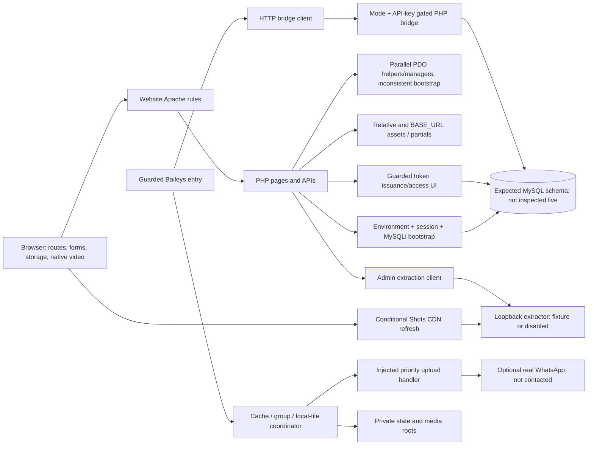

# Current architecture — Jira ZL-11

Date: 2026-10-23 (Asia/Colombo). **Source-grounded static map, not runtime
verification.** Current authority is the existing extracted workspace, including
uncommitted work. Initial HEAD was `a2e5aebf55320e891f5580e7b8825bb32e72cdd8`
on `feat/zl-10-safe-public-export`; the initial index was empty and two
pre-existing documentation edits were preserved. No service, database, bot,
browser session, scheduler, dependency install or external integration was run.

## Observed structure and stack

```text
.
|-- Zinema.lk Website/            PHP entry points, partials, css/js/assets
|   |-- admin/                   login, CRUD, metrics, guarded maintenance
|   |-- api/                     public/social/auth APIs and whatsapp/ bridge
|   |-- includes/                config/DB/session helpers, PHPMailer vendor
|   |-- pages/                   separate sample/TODO prototype pages
|   |-- migrations/              part-schema references, not canonical setup
|   `-- fb-video-api/            guarded Express/HTTP/Chromium extractor
|-- whatsapp-bot-deploy/          guarded Baileys entry and config/ workers
|   `-- database/               three historical SQL generations
|-- scripts/                     syntax/export utilities and export tests
|-- docs/recovery/               historical evidence/status/decisions
|-- docs/architecture/           ZL-11 documentation outputs
`-- .github/                    PR template; no workflows directory observed
```

Ignored private environments, auth/session/media/generated dependencies and
`.recovery-private/` exist outside the content audit. The website user-data dump
is not a schema fixture and was not read. The repository root is not a safe
document root. The current Apache rules are under the website directory.

| Layer | Observed implementation | Verification boundary |
| --- | --- | --- |
| Web | Procedural PHP, mixed HTML/SQL/inline JS/CSS, MySQLi and a parallel PDO helper/manager | 101 first-party PHP files parsed with PHP 8.2.12; no requests executed |
| Browser | Native video/localStorage, fetch/AJAX/sendBeacon, multiple UI/JS generations | 36 total first-party JS/CJS files parsed with Node 24.13.1; browser/inline JS runtime not tested |
| Data | MySQL-oriented SQL, prepared queries, routines/views expected by callers | Six reference SQL files structurally inspected only; actual DB/version/schema unknown |
| Delivery | Baileys socket, API client, forwarding/cache/local-file/queue and workers | Guarded before live imports; never started |
| Extraction | Express/cors/got, optional puppeteer-core/@sparticuz/chromium legacy fallback | Route currently returns configured local fixture or 503 before legacy extraction |
| Dependencies | Bot package + lock; extractor package without lock; empty orphan website lock | No installation, dependency audit or installed-version verification |
| Mail/identity | Explicit PHPMailer files and curl-based OAuth client | Modes gated; no provider/network calls |
| Tooling | Source syntax utility; local export planner/validator/synthetic suite | Existing scripts inspected; ZL-11 executes parser binaries directly, not project scripts |

## Component and trust-boundary map

Arrows below represent source-described intended interactions, not executed flows.



- Browser inputs, session identity, DB content, media URLs and model/provider
  outputs in any future design must be treated as untrusted at their boundaries.
- The shared website bootstrap creates a DB connection and session; it is not a
  pure reusable config import. It reads remember cookies/users and exposes an
  admin-check function; importing it does not itself enforce admin authorization.
- Auth state and media/state files are private runtime data, not source assets.
  Do not move them with code or put them under a future public root.
- Wildcard CORS, shared-key authentication and recovery gates are source facts,
  not a complete authorization/security assurance.
- Local CSP permits self/loopback and blocks general external resources; some
  templates still reference CDN styles/scripts. Actual header/browser effects
  require isolated tests, not weakening guards during migration.

## Web entry points, route and path contracts

Main controllers: `index.php` (Shots), `movies.php`, `tv-series.php`,
`collections.php`, `find_movies.php`, three detail controllers,
`profile.php`, account/reset/verification endpoints, `trailers.php`,
`movie-comments.php`, `whatsapp-watch.php` and guarded `download.php`.

`admin/config.php` is widely imported by public routes as well as admin routes.
Most catalogue/auth/social queries use its MySQLi `$conn`.
`includes/database.php` defines PDO `$pdo`, but the inspected comment/trailer
controllers import the MySQLi bootstrap then use `$pdo`. The existence of the
separate PDO file does not initialize those callers.

| Public URL policy | Source | Relocation constraint |
| --- | --- | --- |
| `/movie/{id}/{slug}` -> `movie-details.php?id={id}` | .htaccess:73-74 | Preserve slug/query forwarding and BASE_URL; do not introduce a new router casually |
| `/series/{id}/{slug}` -> `series-details.php?id={id}` | .htaccess:76-77 | Keep episode/detail links and state keys |
| `/collection/{id}/{slug}` -> `collection-details.php?id={id}` | .htaccess:79-80 | Preserve content association/navigation |
| `/sitemap.xml` -> `sitemap.php` | .htaccess:70-71 | Preserve XML/content type and BASE_URL |
| Single-segment extensionless lowercase/hyphen route -> existing PHP file | .htaccess:82-85 | This is not a universal API or nested PATH_INFO router |
| Direct `.php`, AJAX underscore paths and admin/API files | Physical current paths | Keep exact names/query/method/body/redirect contracts through compatibility wrappers |
| Sensitive/vendor/extractor/upload-execution denials | .htaccess:1-9 | Retain before any public-root change; Apache enforcement not runtime verified |
| HTTPS and www redirects | .htaccess:56-64 | Loopback exemption is for 127.0.0.1; localhost/subdirectory/proxy behavior requires tests |
| ErrorDocument `/404.html`, `/500.html` | .htaccess:87-89 | Both target files absent; do not mask this with a clean syntax result |

No `<base>` element was found in the inspected templates. Several detail assets
use BASE_URL, but navigation form/fetch paths remain relative. A pure URL-model
check (no network) resolved `api/live_search.php` against
`http://127.0.0.1/movie/123/sample` as
`/movie/123/api/live_search.php`; `movies.php` became
`/movie/123/movies.php`. This demonstrates a migration/test risk, not an
observed live 404.

Current alternate browser scripts reference absent `collection.html`,
`collections.html`, `series.html`, `index.html` and `tv-series.html`.
The prototype header references absent `pages/movies.php`. Current rewrite
rules do not explicitly supply those .html aliases. Reachability of every
legacy client is **DEPENDENCY NOT FULLY VERIFIED**; absence of a literal script
include is not proof of safe removal.

## Website flow and API families

| Family | Consumers/callers | Database/configuration boundary | Principal evidence |
| --- | --- | --- | --- |
| Catalogue/detail/search | Public pages, nav, legacy JSON clients | movies/series/episodes/collections; mysqli; BASE_URL and partials | movies.php:3-5,91-117; api/series.php:8-32 |
| Shots/social/saved feed | index/profile and inline fetch | shots/shot_likes/shot_comments/user_favorites/user_views/users; session | index.php:33-105,982-1163; profile.php:32-79 |
| Auth | Forms, repeated overlays, AJAX and JSON clients | users/password_resets; session/CSRF/mail/OAuth; distinct payloads | ajax_login.php:9-20,82-100; api/auth-handler.php:7-28 |
| Admin | Login/layout/CRUD/metrics | admins and domain tables; check_login at individual callers; uploads | admin/config.php:52-55; admin/movies.php:2-59 |
| Movie comments | movie-comments widget -> api/comments.php | PDO expected, mysqli included; comments/users/movies | api/comments.php:2-27; js/comments.js:5,207 |
| Trailer feed | trailers.php / trailer-feed.js / manager | PDO expected, mysqli included; trailer interaction tables | trailers.php:2-17; api/trailers.php:2-18 |
| Analytics | _bottom_nav loads tracker -> sendBeacon | analytics; relative API path and player DOM | _bottom_nav.php:287; js/tracker.js:5,27 |
| Token/access | Detail links -> guarded watch/token helper | token/message/part/bot tables and settings/routines | whatsapp-watch.php:3-8,78; includes/whatsapp_token.php:166-175 |
| Extraction | Conditional public feed and admin ingestion | FB_VIDEO_API_URL; remote URL or local fallback | index.php:451-550; admin/manage_shots.php:12,48,583 |
| Payment/maintenance/diagnostic | Legacy callbacks/CLI/direct URLs | Unreachable legacy data/side effects behind early exits | api/subscribe.php:2-4; admin/run_migration.php:2-4; api/server-check.php:2-4 |

Browser code constructs `api/comments.php/like`,
`api/trailers.php/view` and `api/trailers.php/share`. A corresponding standalone
file/router contract was not established. The PHP handlers primarily dispatch
HTTP method/query action; PATH_INFO/server behavior and response compatibility
remain **DEPENDENCY NOT FULLY VERIFIED**. Do not invent matching endpoints.

## Intended token/delivery sequence and observed defects

1. In a permitted production/live configuration only, watch UI selects a movie
   or episode and calls `createWhatsAppToken` (explicit ten-minute argument).
2. Token helper queries message/part data, optional bot assignment and settings,
   generates a token, then inserts expected token columns. Rate-limit invocation
   is commented out. No token was generated in this audit.
3. Bot entry checks live authorization before imports, then would receive a
   message and call `api-client.getTokenData` through the HTTP bridge.
4. The PHP validator returns validity/error plus token data for inactive, used
   or expired cases. Current bot requires data and rejects already_used, rather
   than positively enforcing every invalid state.
5. Forwarder tries cached/store message data, configured storage/cache groups,
   then local-file upload through priority queue. Reconnect/retry and coalescing
   share state with workers.
6. After reported success the entry marks the token used and logs forwarding.
   The API wrapper can return false on mark-used failure; this is not an atomic
   claim/deliver/acknowledge protocol.
7. A warmer-coalescing branch returns success when warming completes without an
   explicit recipient send in that branch. Recipient acknowledgement must be a
   separate tested contract before “delivered” is trusted.

Old comments describing mandatory night-only uploads/fourth-tier queuing disagree
with `forwardVideo`'s current immediate local upload/final-unavailable branch.
Persistent pending-queue helpers still exist: do not assume that removes all
external or command-level usage. Scheduling and dormant paths require fixtures.

## Bot subsystem boundaries

| Component | Calls/state | Consumers / relocation risk |
| --- | --- | --- |
| index.js | Guard, Baileys auth/store/events, commands, API, worker creation | package entry; moving changes imports and deployment CWD |
| environment.js | Pure explicit process config and path/live guard | imported by entry/API/forwarder; must stay before side effects |
| api-client.js | http/https POST JSON, timeout, API-key header, helper error conversion | entry/workers; preserve configured API base and response shape |
| multi-tier-forwarder.js | socket/store/API/FileManager/UploadQueue, session-root cache/pending JSON | token handler/global warming coalescing; copied JSON is private data |
| upload-queue.js | injected handler, priority/FIFO/dedupe/concurrency/delay | fakeable core; cancellation/completion contract lacks executed regressions |
| file-manager.js | configured media root and content/part naming, filesystem mutations | forwarder/warmer; real files excluded from audit |
| cache-warmer.js | API/socket/files, scheduler, global.activeUploads, __dirname-relative warming-state.json | changing code directory silently changes state-file location |
| auto-refresher.js | API/socket/local paths/reconnect/retry, node-schedule | constructor interval setting differs from fixed 01:00 cron |
| health-monitor.js | os/process metrics/timer + heartbeat/error/stats API | entry/admin metrics; must redact identifiers/errors |
| config/database.js | mysql2 pool and alternate SQL layer | no tracked literal consumer confirmed; external consumers not disproved |
| test-scheduler.js | Date/console diagnostic with no assertions | directly invocable; not a validated suite |

Worker cron strings are interpreted in process-local scheduling context; no
configured production timezone or actual schedule was inspected. The sample
diagnostic uses 00:30 while the current refresher schedules 01:00; the warmer
contains daily/weekly/monthly jobs. No job was started.

### HTTP bridge call map

Source: `whatsapp-bot-deploy/config/api-client.js::apiRequest` and exported helper
functions. Sixteen unique literal endpoint names all have matching files.
This verifies membership, not API behavior or every dynamic/external caller.

| Endpoint | Static file check | Current boundary |
| --- | --- | --- |
| `validate-token.php` | Exists under `Zinema.lk Website/api/whatsapp/` | POST JSON from `apiRequest`; guarded adapter/key boundary; response/DB semantics need fixture tests |
| `mark-used.php` | Exists under `Zinema.lk Website/api/whatsapp/` | POST JSON from `apiRequest`; guarded adapter/key boundary; response/DB semantics need fixture tests |
| `log-forward.php` | Exists under `Zinema.lk Website/api/whatsapp/` | POST JSON from `apiRequest`; guarded adapter/key boundary; response/DB semantics need fixture tests |
| `get-message-id.php` | Exists under `Zinema.lk Website/api/whatsapp/` | POST JSON from `apiRequest`; guarded adapter/key boundary; response/DB semantics need fixture tests |
| `add-message-id.php` | Exists under `Zinema.lk Website/api/whatsapp/` | POST JSON from `apiRequest`; guarded adapter/key boundary; response/DB semantics need fixture tests |
| `needs-refresh.php` | Exists under `Zinema.lk Website/api/whatsapp/` | POST JSON from `apiRequest`; guarded adapter/key boundary; response/DB semantics need fixture tests |
| `log-refresh.php` | Exists under `Zinema.lk Website/api/whatsapp/` | POST JSON from `apiRequest`; guarded adapter/key boundary; response/DB semantics need fixture tests |
| `refresh-stats.php` | Exists under `Zinema.lk Website/api/whatsapp/` | POST JSON from `apiRequest`; guarded adapter/key boundary; response/DB semantics need fixture tests |
| `update-cache-message-id.php` | Exists under `Zinema.lk Website/api/whatsapp/` | POST JSON from `apiRequest`; guarded adapter/key boundary; response/DB semantics need fixture tests |
| `update-forward-stats.php` | Exists under `Zinema.lk Website/api/whatsapp/` | POST JSON from `apiRequest`; guarded adapter/key boundary; response/DB semantics need fixture tests |
| `get-popular-files.php` | Exists under `Zinema.lk Website/api/whatsapp/` | POST JSON from `apiRequest`; guarded adapter/key boundary; response/DB semantics need fixture tests |
| `bot-heartbeat.php` | Exists under `Zinema.lk Website/api/whatsapp/` | POST JSON from `apiRequest`; guarded adapter/key boundary; response/DB semantics need fixture tests |
| `bot-error.php` | Exists under `Zinema.lk Website/api/whatsapp/` | POST JSON from `apiRequest`; guarded adapter/key boundary; response/DB semantics need fixture tests |
| `update-daily-stats.php` | Exists under `Zinema.lk Website/api/whatsapp/` | POST JSON from `apiRequest`; guarded adapter/key boundary; response/DB semantics need fixture tests |
| `log-cache-warming.php` | Exists under `Zinema.lk Website/api/whatsapp/` | POST JSON from `apiRequest`; guarded adapter/key boundary; response/DB semantics need fixture tests |
| `get-aging-messages.php` | Exists under `Zinema.lk Website/api/whatsapp/` | POST JSON from `apiRequest`; guarded adapter/key boundary; response/DB semantics need fixture tests |

Additional endpoint files `get-all-message-ids.php`, `get-message-ids.php`,
`get-movie-parts.php` and `get-popular-content.php` have no literal call in this
client. Shared `config.php` is a helper, not a fifth business endpoint.
Other consumers remain **DEPENDENCY NOT FULLY VERIFIED**.

Most bridge files use shared configuration/key validation;
`get-aging-messages.php` performs its own header extraction. Constant rate-limit
settings in config do not prove enforced request limiting. Update-cache/stats
paths use `movie_message_ids`, whereas add/get/validate paths use
`whatsapp_message_ids` and part tables; `get-popular-content.php` joins
`tv_series` while normal catalogue queries use `series`.

## Database evidence and uncertainty

No database was connected, imported or modified. The excluded website dump was
not opened. SQL inspection extracted DDL/table/column/routine identifiers, not
seed/user-row values. These sources do not prove the installed schema.

| Source or caller family | Observed vocabulary | Meaning / hold |
| --- | --- | --- |
| Website catalogue/auth/social queries | movies, series, episodes, collections, users, admins, password_resets, shots and interaction tables | Caller expectations; no full sanitized CREATE schema established by six references |
| includes/database.php / TrailerManager / comment helpers | PDO, movies/trailers and comment/trailer interaction tables | Separate access contract not wired by current MySQLi bootstrap |
| bot database/schema.sql | video_tokens, forward_logs, media_refresh_log | Older generation; not interchangeable with current bridge naming |
| migration_ultimate_system.sql | ALTER movie_message_ids/whatsapp_tokens; bot health/stats/cache/alerts/cleanup/backup structures; routines | Requires pre-existing structures and reviewed ordering; not a standalone safe installer |
| migration_ultimate_system_FIXED.sql | status-based whatsapp_tokens; bot health/stats/cache/alerts/cleanup/backup structures | Missing message_id/is_used/is_active columns required by inspected current queries |
| migrations/movie_parts.sql | movie_parts and token part-related ALTERs | Explicit source migration; do not ignore or treat as a private dump |
| migrations/episode_parts.sql | episode_parts | Part lookup expected by token and validation paths |
| admin/migrate_shots.sql | ALTER shots video metadata | Source reference; no migration runner executed |
| Bridge/admin callers | whatsapp_tokens, whatsapp_message_ids, movie_message_ids, movie_parts, episode_parts, whatsapp_forward_logs, bot_health_status, bot_statistics, cache_warming_log, system_alerts, v_popular_content | Conflicting generations, views/routines and identifiers need a canonical contract |
| includes/settings.php | site_settings plus runtime CREATE/default INSERT | Reads can mutate schema/data; not pure configuration |
| Token helper distribution logic | settings/site_settings, distribution_groups, fn_get_available_bot | Mixed settings/schema/routine expectations must be reconciled |

Do not rename tables, add columns or import a “FIXED” script merely to make a
static reference resolve. A separate schema proposal and sanitized fixture DB
must precede DB-dependent runtime guarantees.

## Extractor dependency and demonstration requirement

Current service config allows only disabled/local, validates a loopback fake
media URL, and binds loopback. `/health`, `/` and `/api/extract` are declared.
The extraction route returns local fixture data or 503 before retained got/
Chromium code. It is not safe to import the entry during this audit because
`app.listen` is top-level.

Public Shots tries fresh extraction for qualifying Facebook-share URLs, then
cached DB URLs; admin ingestion requires a share URL and optionally attempts
initial extraction. Therefore the extractor is not proven unused or universally
optional in the current dataset. Its **target** need not be part of a core
offline discovery demo if approved, pre-resolved local Shot/media fixtures are
prepared in later work. That fixture dataset/full demo does not exist as a
verified ZL-11 result. Preserve recovery restrictions and isolate the service.

## Development/reproducibility and verification state

- Bot manifest and matching lock are present; no package test script.
- Extractor manifest has no adjacent lock. Website lock has zero package entries
  and no adjacent manifest; it is not an extractor lock.
- No first-party Composer manifest, Docker/compose, framework test configuration,
  unit/integration/e2e directory, lint configuration or GitHub workflows was
  identified in the inspected tracked/nonprivate setup. The bundled PHPMailer
  Composer file is vendor metadata, not root project setup.
- Source syntax and export utilities exist. Prior ZL-10 records report 32
  synthetic export tests; those are packaging tests and were not rerun here.
- No complete sanitized DB, isolated HTTP/browser baseline or end-to-end delivery
  simulator was established. Future AI/conversation/recommendation/voice code is
  PLANNED, not found as an implemented module.

Executed ZL-11 checks: 101 first-party PHP parser passes, 36 JS/CJS parser passes;
150 literal PHP include candidates resolve to existing files; three computed
expressions were manually traced to existing admin/config.php. These are static
filesystem/parse checks, not executed include/route behavior. Inline browser JS
inside PHP is not validated by standalone node --check.

## Complete handler-route candidate ledger

81 handler candidates are listed below. The other 20 first-party PHP files
are helpers/partials/configuration in the [complete module ledger](MODULE_INVENTORY.md).
Excluding them here does **not** mean they are inaccessible by HTTP; direct-access
and public-root policy must be tested separately. Methods/body/query/redirect/
status compatibility is a future regression gate for every listed handler.

| Current URI under website root | Owning group | Static guard/status |
| --- | --- | --- |
| `/admin/analytics.php` | W17 | Admin check_login call |
| `/admin/collections.php` | W15 | Admin check_login call |
| `/admin/cron/cleanup-tokens.php` | W23 | Unconditional recovery 403 exit before legacy body |
| `/admin/cron/reset-daily-stats.php` | W23 | Unconditional recovery 403 exit before legacy body |
| `/admin/episodes.php` | W15 | Admin check_login call |
| `/admin/index.php` | W14 | Admin check_login call |
| `/admin/login.php` | W14 | Bootstrap/handler present; runtime not verified |
| `/admin/logout.php` | W14 | Bootstrap/handler present; runtime not verified |
| `/admin/manage_shots.php` | W16 | Admin check_login call |
| `/admin/movies.php` | W15 | Admin check_login call |
| `/admin/run_migration.php` | W23 | Unconditional recovery 403 exit before legacy body |
| `/admin/series.php` | W15 | Admin check_login call |
| `/admin/settings.php` | W17 | Admin check_login call |
| `/admin/trailers.php` | W15 | Admin check_login call |
| `/admin/whatsapp-bot-tracking.php` | W17 | Admin check_login call |
| `/ajax_forgot_password.php` | W04 | Bootstrap/handler present; runtime not verified |
| `/ajax_login.php` | W04 | Bootstrap/handler present; runtime not verified |
| `/ajax_resend_verification.php` | W04 | Bootstrap/handler present; runtime not verified |
| `/ajax_reset_password.php` | W04 | Bootstrap/handler present; runtime not verified |
| `/ajax_signup.php` | W04 | Bootstrap/handler present; runtime not verified |
| `/api/add_comment.php` | W08 | Bootstrap/handler present; runtime not verified |
| `/api/auth-handler.php` | W04 | Bootstrap/handler present; runtime not verified |
| `/api/check-session.php` | W04 | Bootstrap/handler present; runtime not verified |
| `/api/collections.php` | W10 | Bootstrap/handler present; runtime not verified |
| `/api/comments.php` | W11 | Bootstrap/handler present; runtime not verified |
| `/api/favorite_shot.php` | W08 | Bootstrap/handler present; runtime not verified |
| `/api/get_comments.php` | W08 | Bootstrap/handler present; runtime not verified |
| `/api/like_shot.php` | W08 | Bootstrap/handler present; runtime not verified |
| `/api/live_search.php` | W10 | Bootstrap/handler present; runtime not verified |
| `/api/movies.php` | W10 | Bootstrap/handler present; runtime not verified |
| `/api/payment-notify.php` | W21 | Unconditional recovery 403 exit before legacy body |
| `/api/record_view.php` | W08 | Bootstrap/handler present; runtime not verified |
| `/api/search_content.php` | W10 | Bootstrap/handler present; runtime not verified |
| `/api/series.php` | W10 | Bootstrap/handler present; runtime not verified |
| `/api/server-check.php` | W29 | Unconditional recovery 403 exit before legacy diagnostics |
| `/api/subscribe.php` | W21 | Unconditional recovery 403 exit before legacy body |
| `/api/track.php` | W22 | Bootstrap/handler present; runtime not verified |
| `/api/trailers.php` | W12 | Bootstrap/handler present; runtime not verified |
| `/api/whatsapp/add-message-id.php` | W20 | WhatsApp adapter/key gate (aging uses separate header path) |
| `/api/whatsapp/bot-error.php` | W20 | WhatsApp adapter/key gate (aging uses separate header path) |
| `/api/whatsapp/bot-heartbeat.php` | W20 | WhatsApp adapter/key gate (aging uses separate header path) |
| `/api/whatsapp/get-aging-messages.php` | W20 | WhatsApp adapter/key gate (aging uses separate header path) |
| `/api/whatsapp/get-all-message-ids.php` | W20 | WhatsApp adapter/key gate (aging uses separate header path) |
| `/api/whatsapp/get-message-id.php` | W20 | WhatsApp adapter/key gate (aging uses separate header path) |
| `/api/whatsapp/get-message-ids.php` | W20 | WhatsApp adapter/key gate (aging uses separate header path) |
| `/api/whatsapp/get-movie-parts.php` | W20 | WhatsApp adapter/key gate (aging uses separate header path) |
| `/api/whatsapp/get-popular-content.php` | W20 | WhatsApp adapter/key gate (aging uses separate header path) |
| `/api/whatsapp/get-popular-files.php` | W20 | WhatsApp adapter/key gate (aging uses separate header path) |
| `/api/whatsapp/log-cache-warming.php` | W20 | WhatsApp adapter/key gate (aging uses separate header path) |
| `/api/whatsapp/log-forward.php` | W20 | WhatsApp adapter/key gate (aging uses separate header path) |
| `/api/whatsapp/log-refresh.php` | W20 | WhatsApp adapter/key gate (aging uses separate header path) |
| `/api/whatsapp/mark-used.php` | W20 | WhatsApp adapter/key gate (aging uses separate header path) |
| `/api/whatsapp/needs-refresh.php` | W20 | WhatsApp adapter/key gate (aging uses separate header path) |
| `/api/whatsapp/refresh-stats.php` | W20 | WhatsApp adapter/key gate (aging uses separate header path) |
| `/api/whatsapp/update-cache-message-id.php` | W20 | WhatsApp adapter/key gate (aging uses separate header path) |
| `/api/whatsapp/update-daily-stats.php` | W20 | WhatsApp adapter/key gate (aging uses separate header path) |
| `/api/whatsapp/update-forward-stats.php` | W20 | WhatsApp adapter/key gate (aging uses separate header path) |
| `/api/whatsapp/validate-token.php` | W20 | WhatsApp adapter/key gate (aging uses separate header path) |
| `/collection-details.php` | W07 | Bootstrap/handler present; runtime not verified |
| `/collections.php` | W06 | Bootstrap/handler present; runtime not verified |
| `/download.php` | W19 | Unconditional recovery 403 exit before legacy body |
| `/find_movies.php` | W06 | Bootstrap/handler present; runtime not verified |
| `/google-callback.php` | W05 | OAuth adapter required |
| `/index.php` | W08 | Bootstrap/handler present; runtime not verified |
| `/login.php` | W04 | Bootstrap/handler present; runtime not verified |
| `/logout.php` | W04 | Bootstrap/handler present; runtime not verified |
| `/movie-comments.php` | W11 | Bootstrap/handler present; runtime not verified |
| `/movie-details.php` | W07 | Bootstrap/handler present; runtime not verified |
| `/movies.php` | W06 | Bootstrap/handler present; runtime not verified |
| `/pages/download.php` | W25 | Bootstrap/handler present; runtime not verified |
| `/pages/movie-detail.php` | W25 | Bootstrap/handler present; runtime not verified |
| `/pages/trailers.php` | W25 | Bootstrap/handler present; runtime not verified |
| `/profile.php` | W09 | Bootstrap/handler present; runtime not verified |
| `/reset-password.php` | W04 | Bootstrap/handler present; runtime not verified |
| `/series-details.php` | W07 | Bootstrap/handler present; runtime not verified |
| `/signup.php` | W04 | Bootstrap/handler present; runtime not verified |
| `/sitemap.php` | W01 | Bootstrap/handler present; runtime not verified |
| `/trailers.php` | W12 | Bootstrap/handler present; runtime not verified |
| `/tv-series.php` | W06 | Bootstrap/handler present; runtime not verified |
| `/verify-email.php` | W04 | Bootstrap/handler present; runtime not verified |
| `/whatsapp-watch.php` | W19 | Production/live WhatsApp mode required |

## Handoff

### ZL-11 completion evidence

The original five static-blueprint architecture documents exist and represent all major
website, data, delivery, extraction, tooling and private-boundary groups. The
inventory reconciles all 265 tracked paths into 51 groups: KEEP 10, REPAIR 22,
ISOLATE 12, ARCHIVE CANDIDATE 2, UNRESOLVED 5. Two metadata/exclusion groups are
separate from those counts. Every archive candidate has consumer/test/approval
gates; unresolved and dynamic consumers remain explicitly unverified.

Executed documentation checks: all 195 nonvendor tracked paths occur in the
ledger, plus the 70-file vendor aggregate; all 126 local Markdown links across
the five documents resolved; code fences were balanced and bounded privacy
checks passed. Gitleaks 8.30.1 scanned the five new documents through fully
redacted stdin: exit 0, no findings and no report files. These are artifact
checks, not a full secret/security/rights audit or rendered Mermaid validation.

Before appending the contribution entry, all 188 protected current text-file
hashes matched the values captured at ZL-11 start. This includes the existing
uncommitted BASELINE/CONTRIBUTIONS content, six SQL references and recovery
records. HEAD, committed tree, branch and empty index were unchanged. The only
authorized existing-file change is the appended contribution entry; final
prefix/preservation and document checks are repeated after that append. Private
environments/vendor/binaries are outside byte-level hashing; no writes or moves
were made to those excluded areas.

Completion is **COMPLETE for the static ZL-11 inventory/design scope**. Source
migration, functional parity, installed schema, unknown deployment consumers,
rights, real services and planned AI/simulator behavior remain NOT VERIFIED.
The recovery status/decision files remain preserved historical inputs because
the owner limited this task to new architecture docs and the contribution log.
The current ZL-11 handoff and design decisions are recorded in these documents
and the appended log instead. No Git commit/branch/push or ZL-12 work occurred.

Final checks after the contribution append also passed: 187 protected existing
text files are byte-identical, the entire previous contribution prefix is intact,
and all 188 protected paths are accounted for. Only the intended append differs.
All 128 local links across the six deliverables resolve; fences/privacy/whitespace
checks passed. The final Gitleaks scan of all six artifacts returned exit 0 with
no findings/reports. The baseline checksum file and pre-existing BASELINE edit
remain unchanged; HEAD/tree/branch/index are preserved. Mermaid diagrams were
not rendered, and application runtime verification remains unperformed.

See [target architecture](TARGET_ARCHITECTURE.md), [migration plan](MIGRATION_PLAN.md)
and [debt register](TECHNICAL_DEBT.md). Dynamic/external/deployment dependencies
remain explicitly uncertain. No migration, application repair, account access,
Git mutation or ZL-12 work is authorized or performed by this blueprint.

## Production-planning extension — 2026-10-23

This section extends, rather than restarts, the completed static inventory above.
The original five-document completion evidence remains historical to that pass.
The revised request requires ten architecture documents and a production blueprint;
see [24 gaps and supplied Jira mapping](PRODUCTION_GAP_ANALYSIS.md).
All source references remain current working-tree evidence, not HEAD-only evidence.

### Eight explicit journey traces and evidence status

| Flow | Current trace / boundary | Status and limits | Proposed production closure |
| --- | --- | --- | --- |
| 1. Visitor → Shots → detail → browser playback | index.php Shot linked content type/ID → movie-details.php/series-details.php → native video; movie-details.php:582–619 uses DB MP4 and localStorage resume. Share-URL preview branch can call extractor. | **Source-confirmed / Partially implemented / Not verified** end-to-end. Owner-reported previously working historical system is recorded in provenance, not a current runtime pass. | ZL-17/45 replace direct playback with authorized HLS, legal previews and tests; preserve detail routes. |
| 2. User → search → catalogue → selected title | movies.php/tv-series.php and catalogue API/search handlers → canonical-looking IDs → detail pages. Relative browser endpoints and rewrites affect request paths. | **Source-confirmed / Partially implemented / Not verified**; DB schema, filters and URL resolution are not runtime verified. | ZL-14/16 query/schema reconciliation and rights-aware search; route/browser regression tests. |
| 3. User → login → profile → favorites → history | W04 form/AJAX variants → W02 session/users bootstrap → profile.php saved Shot queries; index.php user_views; player localStorage progress. | **Source-confirmed / Partially implemented / Not verified**; several separate stores, not a verified unified server watch history/watchlist lifecycle. | ZL-19 secure identity/ownership, ZL-17 viewing, ZL-23 opt-in feedback and ZL-53 privacy/deletion. |
| 4. Admin → upload → metadata → publication | admin/movies.php and series CRUD/cover uploads; admin/trailers.php:10–45 trailer upload/thumbnail/INSERT and :51–58 status update; manage_shots.php requires a share URL. | **Source-confirmed / Partially implemented / Not verified**. Upload/status controls exist; licensed publishing, safe ingest, role separation and moderation are not established. | ZL-19/42 quarantine/validation, ZL-15/52 rights workflow and ZL-55 controlled publication. |
| 5. Request → token → bot → cache/fallback | whatsapp-watch.php mode guard → token helper → validate-token API → bot index → multi-tier forwarder/cache/groups/local files → later mark-used. | **Source-confirmed / Partially implemented / Not verified**; owner history does not override disabled current modes. Token status, atomic claim and recipient acknowledgement defects remain. Live delivery **CONDITIONAL**. | ZL-28/54 feasibility, ZL-29/30 contracts and fake tests; independent CDN fallback. |
| 6. Prompt → AI → retrieval → rank → Shots → authorized playback | No implemented complete AI path established; random/unwatched feed is not AI. | **Planned / Not verified**; no provider or runtime execution. | [AI design](AI_ARCHITECTURE.md): ZL-20–25; ZL-16 and rights gates first. |
| 7. Upload → validation → transcode → storage → CDN → HLS | Existing trailer thumbnail command does not establish this pipeline. | **Planned / Not verified**; no object store/CDN or encoder test performed. | [Streaming design](STREAMING_ARCHITECTURE.md): ZL-41–45 with ZL-15/19/52/55 and hosting/security gates. |
| 8. Commit → CI → staging → verify → production | No tracked application workflow/environment/deploy path established; prior manual parser/export checks are narrower. | **Planned / Not verified**; no CI/staging/release execution in this task. | [Deployment design](PRODUCTION_DEPLOYMENT.md): ZL-13/31/46–51/36 with explicit release authorization. |

**Runtime verified:** none of these journeys during ZL-11. Source-confirmed,
owner-reported history, partial implementation and planning are separate evidence
labels; they do not add up to runtime verification.

### Targeted production evidence added without a repeated audit

A bounded search of approved tracked first-party PHP/JS/CJS/JSON found no
Hls/m3u8/dash.js player integration or license-expiry/territory/entitlement/
rights-holder fields. This is an absence in the searched code, not proof about
excluded data, installed schema or externally deployed systems.
Subtitle text matches largely describe UI/CSS/catalogue language labels; they do
not establish timed playable track support.

The two ffmpeg matches lead to admin/trailers.php:24–29: one attempted thumbnail
after upload, conditional only on PHP exec availability. Extension comes from the
original upload name (:17–19), and the command interpolates unquoted paths (:29).
This unsafe shell construction needs a separately authorized security repair;
no command or exploit test was run. Trailer status (:55–58) is metadata, not
rights-aware publication. [TD29](TECHNICAL_DEBT.md) records the finding.

### Production extension decision and records

Retain PHP/MySQL and Node investment; separate application control, isolated media
jobs and private-origin CDN. [Target modules](TARGET_ARCHITECTURE.md) define reuse,
interfaces, runtime placement, security, migration difficulty and tests.
[Streaming](STREAMING_ARCHITECTURE.md), [AI/voice](AI_ARCHITECTURE.md),
[WhatsApp](WHATSAPP_DELIVERY_ARCHITECTURE.md) and
[operations](PRODUCTION_DEPLOYMENT.md) are proposed systems, not current deployments.
All major gaps map to owner-supplied existing stories; inferred sequencing is
**PROPOSED DEPENDENCY**. No Jira status/link was independently verified or changed.

Completion is assessed as a documentation/planning task; runtime, rights and vendor
verification remain future gates. The [contribution extension](../CONTRIBUTIONS.md)
records final checks and preservation. Recovery STATUS/DECISIONS remain historical
inputs because this request permits only architecture and contribution edits.
