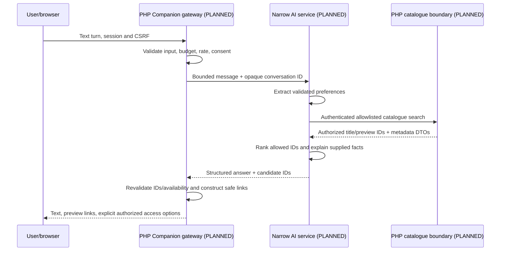

# Target architecture — Jira ZL-11

Date: 2026-10-23 (Asia/Colombo). **Everything in this document is a PLANNED
candidate design, not an implemented layout or verified feature.**
Existing extracted source/working-tree content remains authoritative.
No application folder, service, interface, schema or configuration is changed.

Read the [current map](CURRENT_ARCHITECTURE.md) and
[module dispositions](MODULE_INVENTORY.md) before applying this proposal.
The [migration gates](MIGRATION_PLAN.md) decide when an individual boundary can
move; the tree below does not authorize a bulk move.

## Architectural direction and tradeoffs

Retain PHP, MySQL, plain browser code and Node.js. Start by separating paths and
side effects, not by introducing Laravel, React, an ORM, a bundler, containers,
PSR-4 or a mandatory class hierarchy. Existing procedural functions may remain
procedural behind explicit imports. Framework/dependency changes need a separate
measured proposal. A narrow Node AI service is a future option using the already
present runtime; its provider/library is not selected by ZL-11.

Compatibility PHP entry files remain at existing public URL names during
migration. They delegate to retained handlers/helpers without changing method,
query/body, cookie, output or redirect contracts. Avoid a new universal front
controller until routing requirements and regressions justify it.
Compatibility wrappers are temporary duplication with a known removal gate,
not permission to implement missing behavior.

A single PHP catalogue boundary owns validated DB queries and DTO projection.
Delivery and extraction are optional adapters. The future AI service never owns
the application DB or session store. This limits provider and media coupling
while preserving the technology investment.

## Candidate tree — PLANNED, not created

```text
.
|-- apps/
|   `-- web/
|       |-- public/                    only intended HTTP document root
|       |   |-- .htaccess              preserved rewrite/deny compatibility
|       |   |-- index.php              existing URL wrappers during migration
|       |   |-- *.php                  catalogue/auth/profile/detail wrappers
|       |   |-- admin/                 existing admin URL wrappers
|       |   |-- api/                   existing API URL wrappers
|       |   |-- css/, js/, assets/     preserve old asset URLs first
|       |   `-- favicon.ico, manifest.json, robots.txt
|       `-- src/
|           |-- Config/, Database/    explicit process config and connection factories
|           |-- Auth/, Users/         sessions, auth actions and account contracts
|           |-- Movies/, Series/, Collections/
|           |-- Shots/, Trailers/, Comments/
|           |-- Admin/, Api/, Analytics/
|           |-- ContentAccess/        authorized playback/delivery decisions
|           |-- Views/, Support/      procedural partials/helpers are acceptable
|           `-- Companion/            PLANNED authenticated AI/catalogue gateway
|-- services/
|   |-- delivery/
|   |   |-- core/                     queue/forwarding state machines, no live startup
|   |   |-- clients/website-api/       versioned bridge contract
|   |   |-- adapters/                 simulator, local media, optional WhatsApp
|   |   |-- workers/, observability/, config/
|   |   `-- package.json, package-lock.json
|   |-- media-extractor/              isolated; recovery guard remains
|   `-- ai/                           PLANNED narrow conversation orchestration
|-- database/
|   |-- schema/legacy/                preserved structural references, not auto-install
|   |-- migrations/                   approved canonical versions later
|   `-- seeds/                        fictional/legal fixtures only
|-- tests/
|   |-- unit/, integration/, e2e/
|   `-- fixtures/                    sanitized DB/HTTP/media samples, no real users
|-- scripts/                         safe checks/export and approved maintenance
|-- docs/
|   |-- architecture/, recovery/
|   `-- development/, security/, decisions/  only when a document actually needs them
|-- .github/                         future verified CI, not invented existing workflows
|-- README.md, CONTRIBUTING.md, AGENTS.md, .gitignore
`-- [private runtime roots OUTSIDE public/source export, configured explicitly]
```

Do not create empty folders merely to match this drawing. Public upload URLs
require a separate storage/rights/authorization plan; private media, environments,
sessions, caches and logs do not move into public. The three existing identity
binaries require rights review. Dependency/vendor locations need explicit restore
and licensing decisions; no vendor file is copied into a public application root
just to preserve an old relative include.

The current single root Git repository remains the authority. No nested Git was
observed in nonprivate source parents; preserved private extractor history is
not reinitialized, moved into public source, merged or discarded by this design.

## Boundary contracts

| Boundary | Responsibility | Allowed dependence | Avoid / verify before adoption |
| --- | --- | --- | --- |
| Public wrappers/routes | HTTP/session/auth/CSRF/input/output compatibility | Explicit domain/query/service functions | Implicit CWD, arbitrary dynamic includes, breaking URL/query/body changes |
| Config | Validate process settings; return explicit values/errors | No automatic dotenv, DB, session or network side effects | Root example proposals are not implemented application config |
| Database | Explicit connection/repository contracts and sanitized migrations | Parameterized queries, caller-owned transactions | Global adapter replacement before $conn/$pdo tests; runtime schema creation |
| Auth/session | One explicit lifecycle and identity/role decisions | Config, user queries, fakeable mail/identity adapters | Moving admin/config without public caller and cookie coverage |
| Domain queries | Catalogue/Shot/series semantics and DTOs | Approved read/write repository functions | SQL/HTML/media-provider logic mixed in views |
| Views/assets | Rendering/DOM/accessibility and stable URL/storage keys | DTOs and documented browser API contracts | Consolidating CSS/JS copies during path-only changes |
| Delivery core | Request/claim/queue/send/ack state and retries | Injected clock, store, website client and delivery adapter | Socket/module startup in imports, shared globals, treating warm success as recipient ack |
| Delivery adapters | Fictional simulator by default; optional real WhatsApp separately gated | Explicit transport interface and private runtime roots | Real credentials/accounts/media in tests or a “simulator” bypassing live guards |
| Extractor | Optional media-resolution interface, disabled/local fixture default | Bounded local fixture contract; later reviewed provider adapter | Blindly reviving got/Chromium URL logic, arbitrary server-side fetch |
| AI service | PLANNED dialogue/preferences/ranking/explanation | Narrow authenticated catalogue DTO interface and provider abstraction | Direct SQL/DB credentials, arbitrary tool execution, model-authoritative authorization |
| Observability | Redacted request/job IDs, status and aggregate metrics | Structured bounded events | Raw tokens, chat IDs, session paths, audio or full provider/API responses |

Keep the current disabled ads helpers as compatibility no-ops. Commercial/payment
and destructive maintenance paths remain quarantined. Direct-database bot client
and uncertain scripts remain UNRESOLVED until consumer ownership is established.

## Planned future AI Movie Companion — no implementation in ZL-11

All following modules, URLs, contracts and settings are **PLANNED / NOT IMPLEMENTED**.
ZL-11 makes no provider requests, adds no SDK and activates no AI feature.

### Responsibilities and data ownership

| Planned component | Input/output | Ownership / security constraint |
| --- | --- | --- |
| Conversation gateway | Authenticated text turns -> bounded response DTO | PHP enforces session/CSRF/rate/budget rules before service use |
| Preference extraction | User-stated mood/genre/theme/duration/context/dislikes/similar-title preferences -> validated structured fields | No diagnosis or inferred sensitive identity; reject unsupported fields, allow user corrections |
| Trusted catalogue retrieval | Bounded filter/preferences -> authorized catalogue IDs/metadata/Shot associations | PHP read-only allowlisted query functions; model text is never SQL |
| Recommendation ranking | Retrieved candidates + validated preferences -> ordered allowlisted IDs/scores | Deterministic baseline and optional provider rerank; reject unknown/unavailable IDs |
| Explanation generation | Verified metadata + selected IDs -> short reasons | Tie explanation to supplied facts; do not invent availability/cast/release details |
| Optional voice/UI | Explicit user microphone/text interaction -> same message contract | Opt-in, keyboard/text fallback, captions, reduced motion; no automatic recording |
| Shots integration | Verified catalogue IDs -> associated approved preview IDs | No arbitrary model-supplied video URLs; server validates association/rights |
| Content access | Verified title ID -> current authorized playback or simulated delivery option | PHP checks access/rights; model cannot mint tokens, choose accounts or enable live adapters |

### Planned flow



The service call is internal and authenticated, not an internet-facing DB query
endpoint. Whether preference extraction is deterministic or model-assisted is a
future decision. Begin with a catalogue-only deterministic fallback and narrow
tests, not a general autonomous tool agent.

### Proposed API boundary examples — PLANNED

- Browser -> PHP: `POST /api/companion/messages`; a bounded message and opaque
  conversation handle. Method/route/schema are proposals, not current files.
- PHP -> AI service: internal turn request with minimal context, request budget,
  deadline and server-created request ID. Do not forward browser session cookies.
- AI service -> PHP catalogue boundary: authenticated read-only structured search;
  allowlisted genres/types/duration/pagination. No arbitrary field/table/order/SQL.
- Response DTO: text, verified content type/ID, brief reason and approved preview
  references. PHP constructs same-origin detail links and rejects ungrounded IDs.
- Existing `api/search_content.php` is an inspected consumer-facing endpoint,
  not automatically a secure service-to-service catalogue API. Build/test the
  projection and authentication policy separately before reusing it.

A proposed catalogue DTO may contain title ID/type, title/year, curated genre/
duration/description metadata, approved preview IDs and an availability flag.
It excludes user records, credentials, signed media URLs, chat/account identifiers
and private filesystem paths. Do not use fictional API examples as implemented
feature or competition-period authorship evidence.

### Privacy, failure and operational policy — PLANNED

- Minimize retained conversation state, set a short explicit TTL and permit
  deletion; default demos use fictional, ephemeral conversations. No private
  prompts, messages, audio or mood history enters public logs or fixtures.
- Voice is optional and separately consented. No background microphone, persistent
  raw audio, inaccessible animation or mandatory speech-only workflow.
- Treat catalogue/provider text as untrusted data. Prompt instructions cannot
  grant new tools, change query policy, expose config, bypass access checks or
  override request limits. Server validation remains outside model control.
- Provider timeout/unavailability/budget exhaustion -> safe catalogue-only
  fallback and clear retry guidance; no automatic switch to live delivery.
- Reject unknown IDs/invalid DTOs; incomplete catalogue data -> honest limited
  suggestions, not invented facts. Distinguish unavailable titles from errors.
- Bound messages/history, request frequency, daily usage, timeout, concurrency
  and provider spend in server code. Root FUTURE_* examples are proposals only
  and enforce none of these limits today.
- Provider selector/key/model configuration stays server-side and disabled by
  default; no key in JS, HTML, Markdown or export. Runtime secrets come from a
  separately approved process/secret configuration boundary.
- Future service identity, CSRF/auth checks, audit-redaction policy, request IDs,
  cancellation/retry and versioned error envelopes need contract tests.
- No cloud service, hosting, provider, price or competition rule is selected or
  verified in this no-network source-based task.

## Planned delivery and media abstraction

A future delivery interface should accept a server-validated content/part request
and return explicit accepted/queued/sent/acknowledged/failed states. Cache warm-up,
upload completion and actual recipient acknowledgement must not collapse into a
single success boolean. Define idempotency/claim ownership and retry deadlines
before implementing any migration of token behavior.

The simulator is a **new future adapter**, not the existing Baileys entry with
guards disabled. It uses fictional recipients, legal local samples and fake
clock/HTTP/store boundaries. No actual account/group/session can be selected.
Real WhatsApp remains optional and separately authorized; it is not a permanent
CDN or core AI dependency.

Extractor input restrictions, redirects, network destinations, DNS/IP validation,
timeouts, response size and rights need a separate threat model before any live
resolution is considered. Retained unreachable code is not an approved adapter.

## Compatibility and migration principles

1. Preserve direct PHP and clean URLs, query parameters, POST formats and response
   bodies/headers/redirects before making paths prettier.
2. Preserve includes through explicit retained shims; introduce stable app/config/
   public/state roots gradually. Do not change CWD as an accidental API.
3. Migrate a pure/low-side-effect leaf first. Do not start with admin/config,
   session lifecycle, schema, bot entry or the document root.
4. Keep old asset URLs and browser storage keys until a tested transition;
   hash/versioning/bundling choices are separate changes.
5. Keep service manifests and locks together; state/media paths are explicit
   outside public source. Dependency upgrades are not path refactoring.
6. Separate canonical-schema repair, security fixes and AI features from
   structural movement. Existing incompatibilities must be characterized and
   resolved in their own approved work before promising the recovered journey.
7. Preserve baseline records and source checksums; record intentional deltas,
   never regenerate old evidence merely to hide change.
8. Review the export allowlist explicitly after new/moved paths. Current export
   tooling withholds unapproved paths, including these new architecture files;
   this task does not change policy or execute an export.

## Decisions and unresolved choices

The initial decisions here are source-informed proposals: retain the stack,
compatibility wrappers and procedural helpers; centralize explicit boundaries;
isolate optional delivery/extraction/AI; preserve private history and unknown code.
They do not approve deployment topology, framework adoption, DB schema/version,
provider, voice technology, production scheduler timezone, legal-media rights or
archive removal. Resolve those with fixtures, owners and measured evidence.

No restructuring is implemented. ZL-12 is the next proposed task and must begin
with the prerequisite gates in [MIGRATION_PLAN.md](MIGRATION_PLAN.md).

## Production extension: architecture placement and reuse

This section extends the candidate tree and contracts above. It does not create
directories or supersede compatibility wrappers. Retain PHP/MySQL as one application
boundary; separate Node delivery only where transport/long-running work needs it.
AI orchestration can start inside PHP behind a provider interface; a separate Node
AI runtime is optional, justified by measured concurrency/cancellation needs.
Media processing warrants a restricted worker or managed job runtime because
untrusted parsers and CPU-heavy jobs should not run in a web request.

Additional candidate paths, **PLANNED / NOT CREATED**, within the same tree:

~~~text
apps/web/src/
  Catalogue/             eligible projections over Movies/Series/Collections
  Media/                 asset metadata, ingest intents and processing jobs
  Rights/                grants, territory/window, publication decisions
  ContentAccess/         playback descriptor and renewal authorization
  Companion/             text/voice gateway and optional provider interface
services/
  media-worker/          bounded validation/probe/transcode adapter
  ai/                    optional only if a separate runtime is justified
infra/
  environments/          reviewed dev/staging/prod definitions
  modules/               small reusable infrastructure definitions when needed
tests/
  contracts/             catalogue/playback/job/delivery interfaces
  media/                 tiny legally usable generated/licensed fixtures
~~~

No repository-root document root, exposed private origin, credentials in client
code, direct AI database access, live default messaging or universal rewrite is
introduced by this proposal. The original src/Movies/Series/Collections own domain
operations; Catalogue is a read/projection boundary, not duplicate authoritative
records or a second database.

### Production module contracts

Each row states why the boundary exists, source to retain, interface/dependencies,
placement/security, difficulty and future tests. Difficulty estimates are planning
judgments, not effort promises. “New” means no established current implementation.

| Proposed module / responsibility | Current source to reuse | Interfaces and dependencies | Runtime / security boundary | Migration difficulty / tests |
| --- | --- | --- | --- | --- |
| Web frontend: routes, views, controls/a11y | W01/W06–W13/W27 PHP views, CSS/JS and native player | Stable wrappers and DTOs; catalogue/auth/player contracts | Browser plus PHP rendering; escaped values, CSP, no credentials | High for mixed pages; route/query/DOM/keyboard/mobile tests |
| Application HTTP/backend | W01/W02/W10 existing handlers/helpers | Explicit request DTO/response, Config, Auth, repositories | PHP under intended public root; validate request/CSRF/ownership | High; include/CWD/status/error parity |
| Auth and users | W02/W03/W04/W05/W09 | Session/identity/role contract, user repository, fakeable mail/OAuth | PHP; secure cookies/expiry and server roles; provider keys private | High; reset/login/role/CSRF/ownership/negative tests |
| Catalogue and search | W06/W07/W10 movie/series/collection/episode logic | CatalogueQuery/DTO; Database and Rights; pagination/search | PHP; published entitled rows only, parameterized queries | High; canonical fixture schema and stable IDs/filter contracts |
| Shots/social/history | W08/W09/W11/W12 | Linked canonical IDs, user-scoped social operations, eligible media DTO | PHP/browser; preview rights and moderation, consented history | High; like/comment/favorite concurrency and end-to-end title link |
| Administration/moderation | W14–W18 CRUD and dashboard UI | Draft/edit/review/publish commands; roles, Rights, Media | PHP restricted roles/MFA; auditable changes, safe uploads | High; unauthorized requests, CSRF, publish/takedown tests |
| Rights and entitlements | Catalogue identity only; grant control is new | evaluate(identity, content, territory, time, action), publication gate | PHP owns final decision; no model/provider override | High; expiry, territory, revocation, preview/audio/subtitle scope |
| Media management/ingest | W15 upload UI and title linkage, not unsafe shell behavior | Upload intent/complete, asset versions, validation jobs/outbox | PHP control + private quarantine; publisher ownership/limits | High; corrupt/oversize/spoofed upload, idempotency and provenance |
| Video encoding | Trailer thumbnail requirement only; pipeline new | Typed asset job → validated rendition/version manifest; queue/storage | Restricted worker or managed job, bounded resources/no arbitrary egress | High; legal fixture encode/probe/retry/partial-output/poison jobs |
| Streaming authorization | W07 detail IDs and play action | Playback-session/renewal DTO; Rights, Auth, ready asset versions | PHP signs narrowly scoped edge access; never origin keys | High; expired/other-user/unpublished/territory and renewal tests |
| CDN delivery | No established existing private streaming CDN | Signed manifest/segments/tracks; private origin and immutable objects | Edge/data plane; origin denies public access | High; direct-object denial, cache isolation, takedown/device tests |
| AI and recommendation | W06 catalogue and W08 links; no existing AI to move | Typed preferences → authorized retrieval → deterministic rank → validated explanation | PHP interface initially; optional Node orchestration; no SQL/DB secrets | Medium/High new feature; grounded IDs, injection, fallback, budget tests |
| Voice companion | Existing UI assets only; voice new | Explicit STT/TTS adapter with text/transcript and cancellation | Browser consent + server provider calls; no raw-audio retention default | Medium/High; denial, stop/mute, text, a11y/reduced-motion/mobile |
| Optional delivery adapter | B01–B09/B12 and W19/W20 contracts, preserving disabled guards | capabilities/request/claim/send/status; queue/store/clock/API | Node worker; private sessions, approved provider only | High; fake recipient acknowledgement/token races/restart/timeout |
| Database access/migrations | W02/D01/D02 and queried table vocabulary | Explicit repositories/transactions; canonical schema/version ledger | Private MySQL; separate application and migration roles | High; reconcile PDO/MySQLi, FK/index/query/rollback fixtures |
| Background jobs | B05/B07/B08 scheduling responsibilities | Durable IDs/leases/outbox, clock/retry/dead-letter/reconciliation | Worker; timezone explicit, bounded concurrency, secrets isolated | High; fake-clock/cancel/restart/duplicate-job tests |
| Monitoring/infrastructure | W17/W22/B09 intent, not proof of deployed controls | Redacted events/metrics, health endpoints, env/IaC/release contracts | Operator plane, least privilege; no token/audio/chat payloads | Medium/High; alert/backup/restore/deploy/rollback/cost drills |

No new microservice is required for each row: these are responsibility boundaries.
Most remain functions/modules inside the existing PHP application; queue and encoding
may use a managed facility after vendor review. Retain existing compatibility paths
until each affected migration has before/after evidence.

### Security, rights and availability decisions

A private-origin CDN path is independently viable when AI, voice, extraction and
messaging are off. Discovery is not authorization: repeat entitlement/territory/
expiry checks when issuing and renewing playback. Licensing must cover each full
title, episode, Shot/clip, poster, subtitle and audio track; technical retrieval or
upload does not grant permission. Publication and takedown own an audit trail and
urgent revocation path. Applicable legal obligations are unverified owner/legal
decisions, not asserted compliance.

Boundaries for public users, accounts, admins/publishers, ingest, playback/CDN,
AI/messaging providers, database and secrets are defined in
[deployment security controls](PRODUCTION_DEPLOYMENT.md).
Signed access is not DRM or a promise to prevent recording.
No stored credential, legal agreement or private media contents were inspected.

### Focused production designs and Jira

- [Streaming architecture](STREAMING_ARCHITECTURE.md): minimum/growth options,
  job lifecycle, HLS tracks, playback descriptor, origin denial, retention/costs.
  ZL-41–45, ZL-15/16/19/52/55.
- [AI/voice architecture](AI_ARCHITECTURE.md): constrained IDs/preferences/ranking,
  validated explanation, opt-in history and explicit microphone controls.
  ZL-20–27.
- [Delivery architecture](WHATSAPP_DELIVERY_ARCHITECTURE.md): preserve current
  token/cache/queue evidence, strict claim/ack, provider-neutral optional adapter.
  ZL-18/28–30/54.
- [Deployment](PRODUCTION_DEPLOYMENT.md): logical environments, runtime/IaC,
  CI/CD, private data, monitoring, backups/restore, incidents/budget.
  ZL-13/31/35/36/46–51.
- [Gap/Jira map](PRODUCTION_GAP_ANALYSIS.md): all 24 areas, supplied 12 epics/43
  stories and **PROPOSED DEPENDENCY** release path. No issue state inferred.

Provider selection and pricing remain **REQUIRES CURRENT VENDOR VERIFICATION**.
The next task title is **ZL-12 — Refactor modules incrementally without route
regressions**; prerequisites and stop gates still apply. It is not started.
